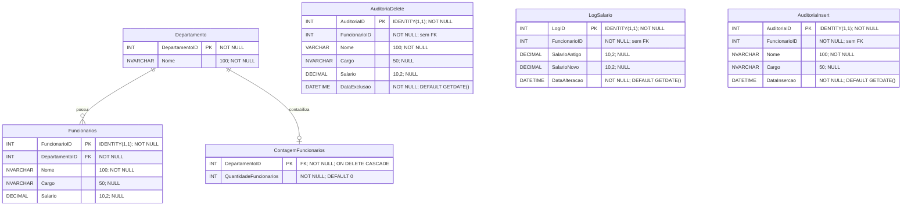

# Diagrama Entidade Relacionamento

`DepartamentoID` em `Departamento` é informado manualmente; o exercício usa o ID 2 para representar o RH. `FuncionarioID`, `AuditoriaID` e `LogID` são `IDENTITY(1,1)`. Os `FuncionarioID` das tabelas de auditoria e histórico não são chaves estrangeiras, para preservar os registros mesmo após a exclusão de um funcionário.
